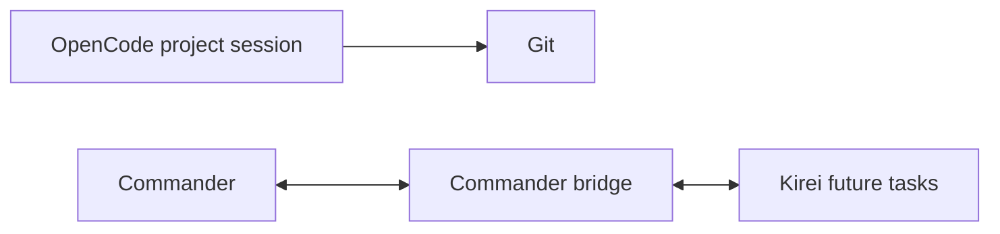

# Digitaltwin

Digitaltwin is a thin companion to OpenCode. OpenCode owns project chats, agents, remote workspaces, and Git feedback; Digitaltwin adds Commander and durable future commitments.

## Why it exists

Project work stays in OpenCode and Git. Commander is the one cross-project surface for durable context, follow-ups, and scheduled check-ins. Kirei stores and delivers future commitments only; it does not proxy ordinary project prompts, transcripts, agent events, approvals, or reviews.

The outcome is a small remote team that can preserve context across restarts and make its work inspectable, while still stopping for the human decisions that matter.



This diagram is the intended product boundary, not a claim of production runtime connectivity.

## Commander

Commander opens beside an existing OpenCode project session without replacing it. It streams, steers, reconnects, and cancels its own work through a typed main-process boundary.

## What is available today

The reviewed local core now starts PostgreSQL plus Kirei web and worker processes only. It includes versioned one-time FutureTasks, durable due-job executions, disposition records, and a fail-closed Commander delivery boundary. The OpenCode Commander patch has passing component and Linux/Xvfb Electron harness evidence, but its synthetic local bridge is not production runtime connectivity.

## Components

| Component | Responsibility |
| --- | --- |
| [integration-backend/](integration-backend/README.md) | Kirei future-task persistence and worker boundary. |
| [commander/](commander/opencode-ui-patch/README.md) | OpenCode Commander patch, bridge contract, and local harness evidence. |
| [scripts/](scripts/README.md) and [tests/](tests/README.md) | Local Kirei/PostgreSQL checks and migration evidence. |

## Run the credential-free local core with Docker

Docker Desktop (or a compatible Docker daemon) must be running. The sample values in `.env.example` are public local-development passwords, never production secrets.

```sh
docker compose --env-file .env.example config --quiet
scripts/acceptance config
scripts/acceptance dependencies
scripts/dev
```

`scripts/dev` preserves an existing ignored `.env` and runs `docker compose up -d --wait`. The default core starts PostgreSQL plus Kirei web and worker services after migrations. Run `scripts/dev --build` after changing an image input; it removes this stack's superseded dangling images after a successful rebuild.

For the equivalent manual flow, run `cp .env.example .env`, then `docker compose up -d --wait`. Use backend `/livez` or `/readyz` only as process health signals—not as evidence of a production Commander runtime.

Stop the local stack with `docker compose down`; volumes are retained for the next boot. Use `docker compose down --volumes` only for deliberately disposable data. Changing `.env` does not rotate roles in an existing PostgreSQL volume.

OpenCode installation, operator runtime credentials, mobile access, production deployment, networking, TLS, backups, and secrets remain outside this Compose file.

## Learn more

- [Repository layout and parallel build](docs/repository-layout-and-parallel-build.md)
- [Shared service boundaries and validation gates](docs/interfaces/service-boundaries.md)
- [Commander patch and local harness](commander/opencode-ui-patch/README.md)
