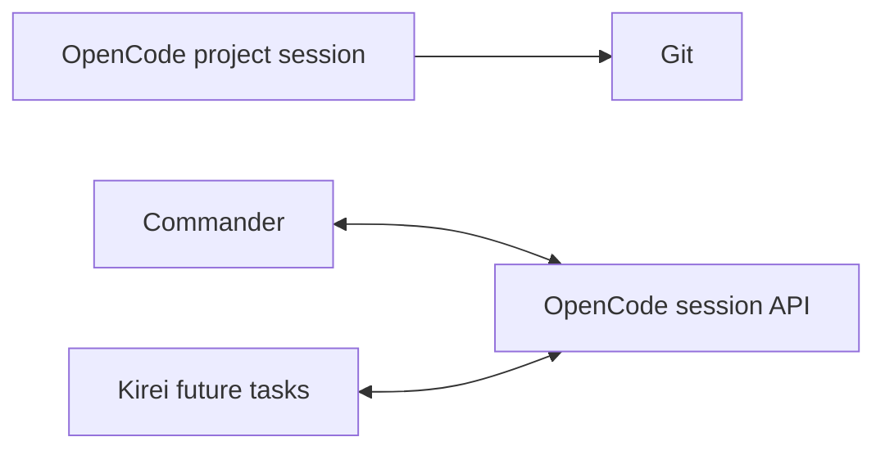

# Digitaltwin

Digitaltwin is a thin companion to OpenCode. OpenCode owns project chats, agents, remote workspaces, and Git feedback; Digitaltwin adds Commander and durable future commitments.

## Why it exists

Project work stays in OpenCode and Git. Commander is the one cross-project surface for durable context, follow-ups, and scheduled check-ins. Kirei stores and delivers future commitments only; it does not proxy ordinary project prompts, transcripts, agent events, approvals, or reviews.

The outcome is a small remote team that can preserve context across restarts and make its work inspectable, while still stopping for the human decisions that matter.



This diagram is the intended product boundary, not a claim of production runtime connectivity.

## Commander

Commander opens beside an existing OpenCode project session without replacing it.
Its normal continuation and Kirei check-ins use the existing authenticated
OpenCode session API; no private Node bridge or browser credential path exists.

## What is available today

The reviewed local core now starts PostgreSQL plus Kirei web and worker processes only. It includes versioned one-time FutureTasks, durable due-job executions, disposition records, and a fail-closed OpenCode delivery boundary. Operator-provided OpenCode authorization and live desktop interaction remain validation work outside this repository.

## Components

| Component | Responsibility |
| --- | --- |
| [integration-backend/](integration-backend/README.md) | Kirei future-task persistence and worker boundary. |
| [commander/](commander/opencode-ui-patch/README.md) | OpenCode Commander patch and normal-session continuation contract. |
| [commander/future-work/](commander/future-work/SKILL.md) | Shared future-check-in operating skill for supported agents. |
| [scripts/](scripts/README.md) and [tests/](tests/README.md) | Local Kirei/PostgreSQL checks and migration evidence. |

## Run everything locally

With Postgres.app already running on `127.0.0.1:5432`, start Kirei web, the
Kirei worker, and the prepared patched OpenCode desktop from the repository root:

```sh
sh scripts/local-overmind
```

The checked-in `.env.overmind` contains only ordinary local database, port, and
path settings. It creates `digitaltwin_local` and `digitaltwin_local_test` only
when absent, refuses databases owned by another role, and keeps its socket,
heartbeats, logs, and temporary files under `local/`.

```sh
sh scripts/local-overmind status
sh scripts/local-overmind logs
sh scripts/local-overmind stop
```

OpenCode is the single desktop process and starts its local sidecar itself; do
not run a separate OpenCode server. The first start needs the prepared
`local/opencode` checkout described in [`commander/LOCAL_E2E.md`](commander/LOCAL_E2E.md).
Commander defaults are checked into `.env.overmind`; provider credentials remain
in the user's existing OpenCode setup.

## Run the credential-free local core with Docker

Docker Desktop (or a compatible Docker daemon) must be running. The sample values in `.env.example` are public local-development passwords, never production secrets.

```sh
docker compose --env-file .env.example config --quiet
scripts/acceptance config
scripts/acceptance dependencies
scripts/dev
```

`scripts/dev` preserves an existing ignored `.env` and runs `docker compose up -d --wait`. The default core starts PostgreSQL plus Kirei web and worker services after migrations. Run `scripts/dev --build` after changing an image input; it removes this stack's superseded dangling images after a successful rebuild.

For the equivalent manual flow, run `cp .env.example .env`, then `docker compose up -d --wait`. Use backend `/livez` or `/readyz` only as process health signals—not as evidence of a production Commander runtime.

Stop the local stack with `docker compose down`; volumes are retained for the next boot. Use `docker compose down --volumes` only for deliberately disposable data. Changing `.env` does not rotate roles in an existing PostgreSQL volume.

OpenCode installation, operator runtime credentials, mobile access, production deployment, networking, TLS, backups, and secrets remain outside this Compose file.

## Learn more

- [Repository layout and parallel build](docs/repository-layout-and-parallel-build.md)
- [Shared service boundaries and validation gates](docs/interfaces/service-boundaries.md)
- [Commander OpenCode patch](commander/opencode-ui-patch/README.md)
